# Assignment 3: Responsive Web Design
Name: Kaussar Meirambekkyzy
Group: IT-2513

---

## Task 0: Responsive Typography
In this task, I practiced CSS media queries to change font sizes depending on the screen width. On mobile screens the text is smaller, on tablets it gets medium size, and on desktop screens it becomes larger.

Mobile View:
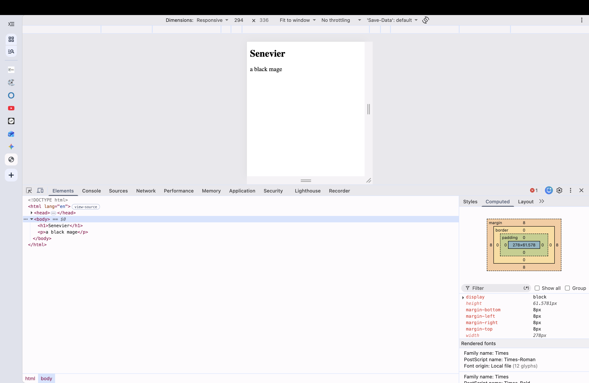

Tablet View:
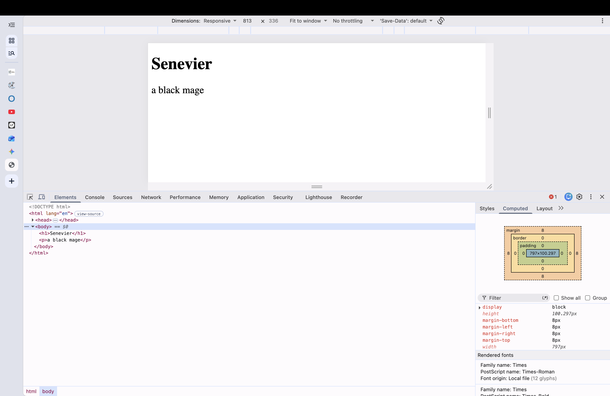

Desktop View:
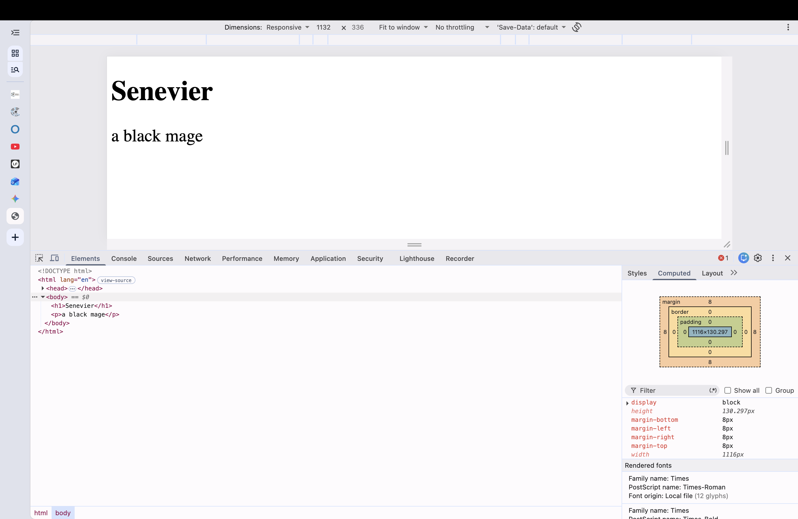

---

## Task 1: Responsive Layout with Media Queries
I created three content boxes using pure CSS and Flexbox without Bootstrap. The layout changes based on the device width:
- Mobile: All three boxes are stacked vertically in one column.
- Tablet: Two boxes stay in the first row, and the third box moves to the second row.
- Desktop: All three boxes are aligned side by side in one row.

Mobile View:
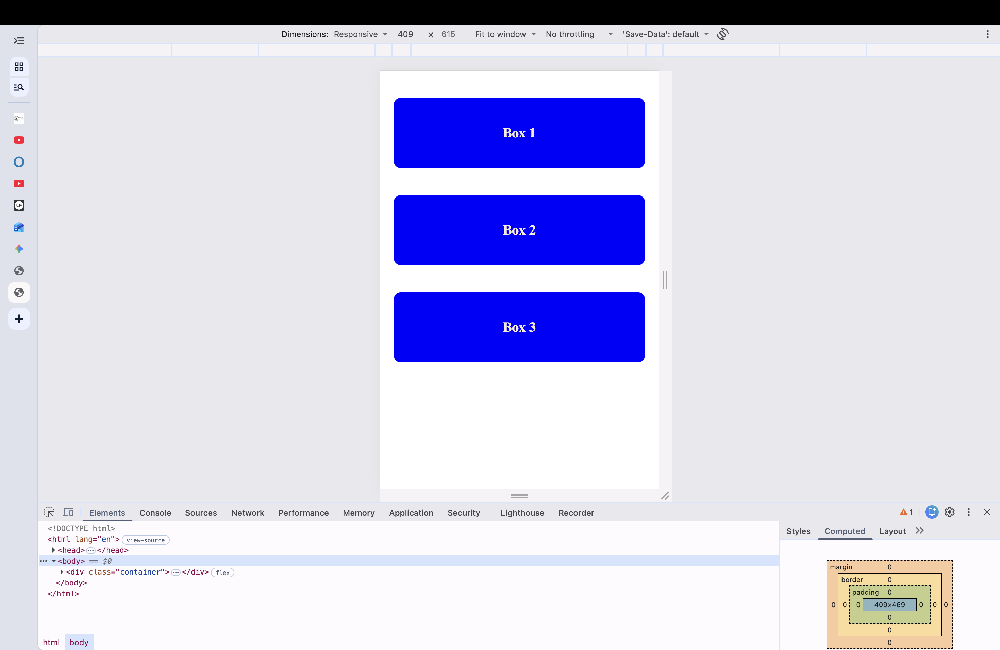

Tablet View:
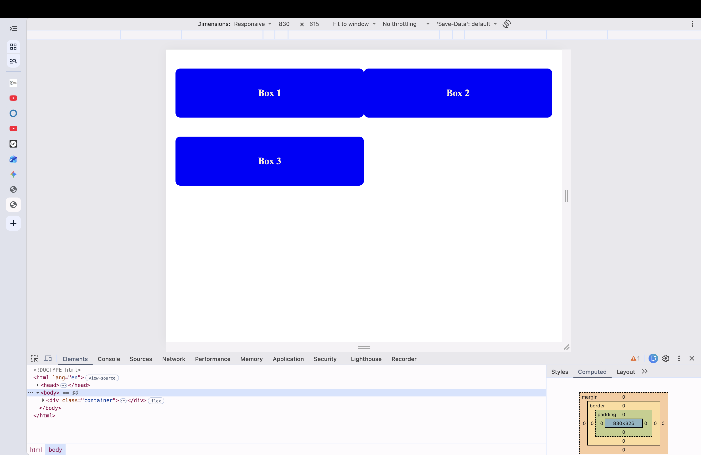

Desktop View:
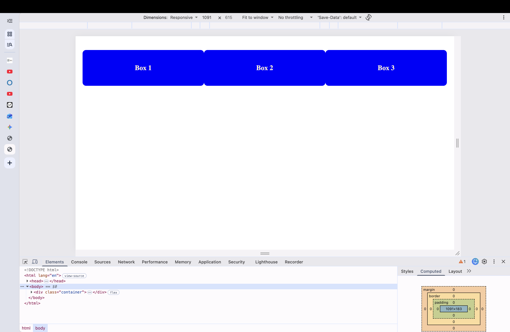

---

## Task 2: Bootstrap Responsive Columns
In this task, I used the Bootstrap 12-column grid system to make three responsive cards:
- Mobile: Each column takes 12 parts, so they stack on top of each other.
- Tablet: Each column takes 6 parts, showing two columns on the first line and one on the next.
- Desktop: Each column takes 4 parts, so all three fit into one row.

Mobile View:
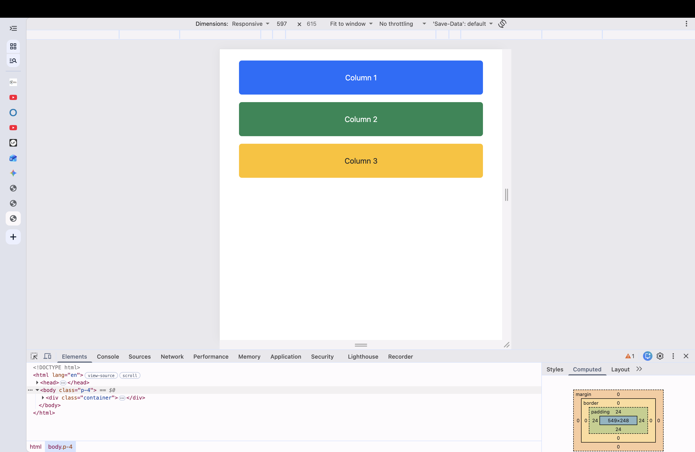

Tablet View:
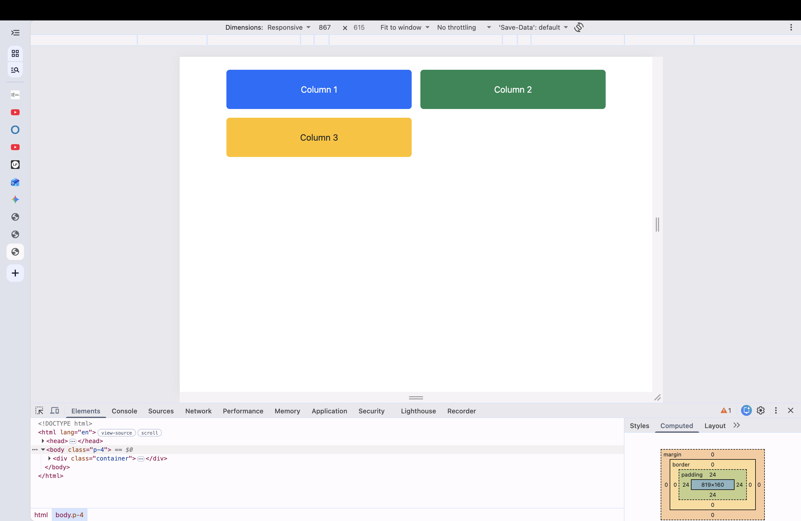

Desktop View:
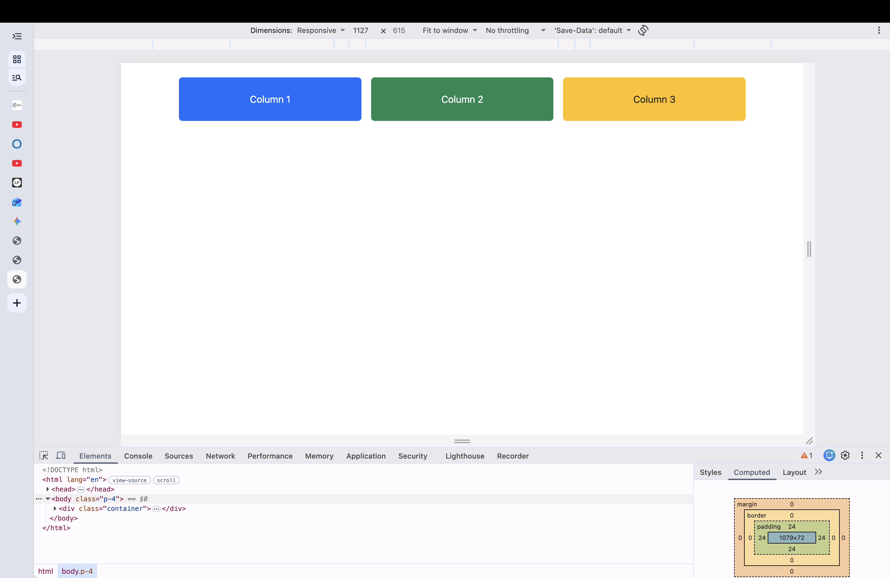

---

## Task 3: Bootstrap Navigation Bar
I built a responsive navbar using Bootstrap. On large screens, the logo is on the left and the links are on the right. When the screen becomes smaller, the menu collapses into a hamburger button that opens and closes on click.

Desktop View:
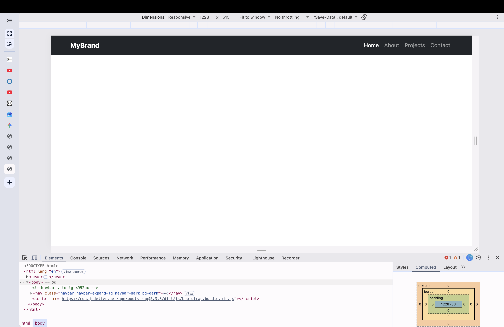

Mobile View :
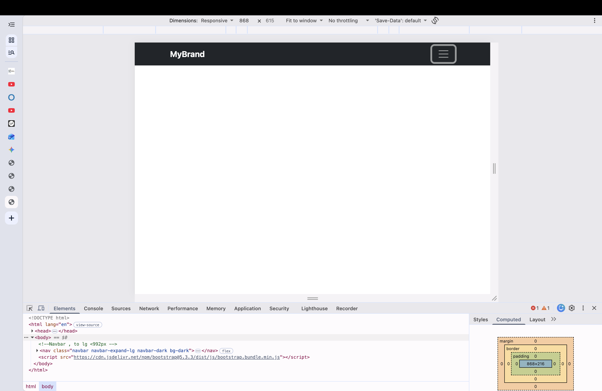

Mobile View (Open):
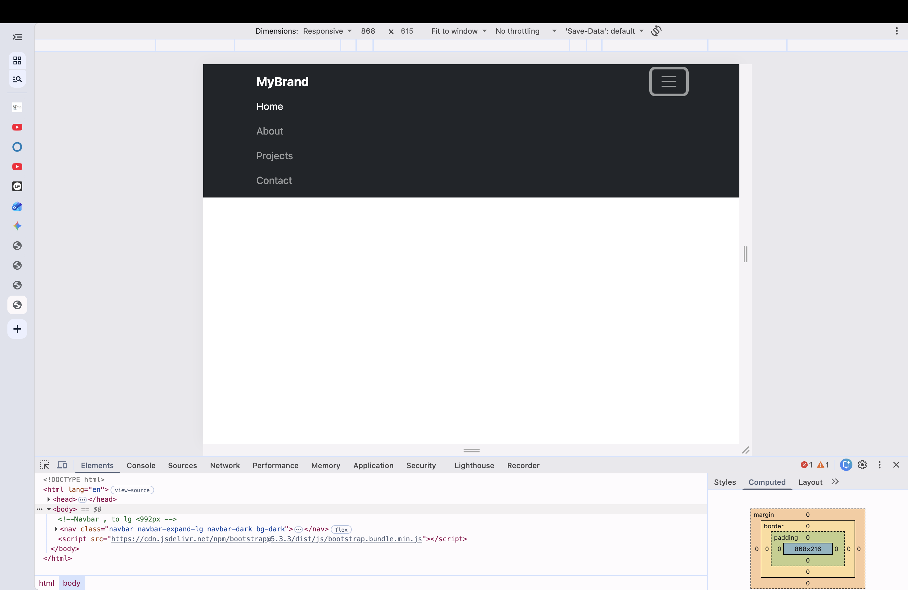

---

## Task 4: Responsive Portfolio Page
For the final task, I combined Bootstrap Grid and custom CSS media queries to make a portfolio page:
- Header has a responsive navbar with a toggler button.
- Main section is split into two parts: the left side has project cards built with a nested grid, and the right side is a sidebar with personal info and contacts.
- Footer is placed at the bottom across the whole width.
- I also used custom media queries to center the headings and adjust spacing for mobile screens.

Mobile View:
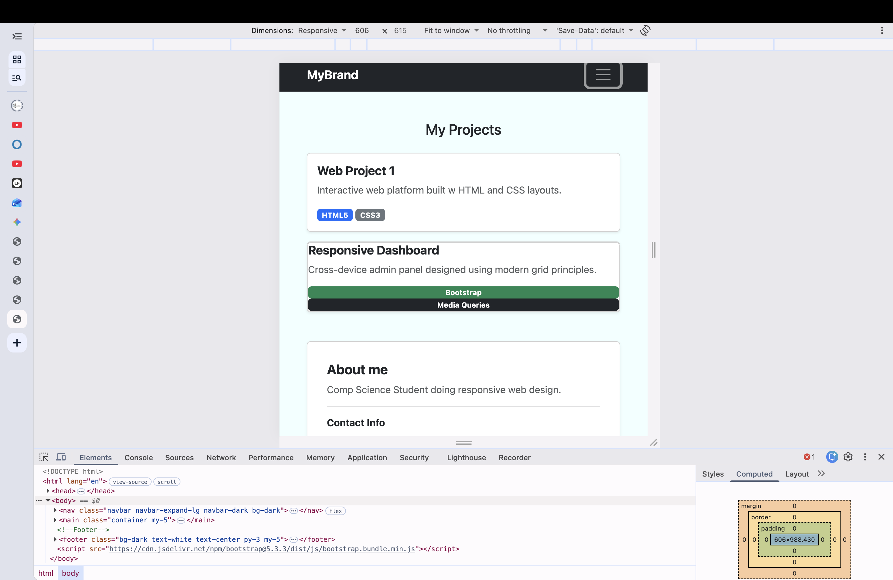

Tablet View:
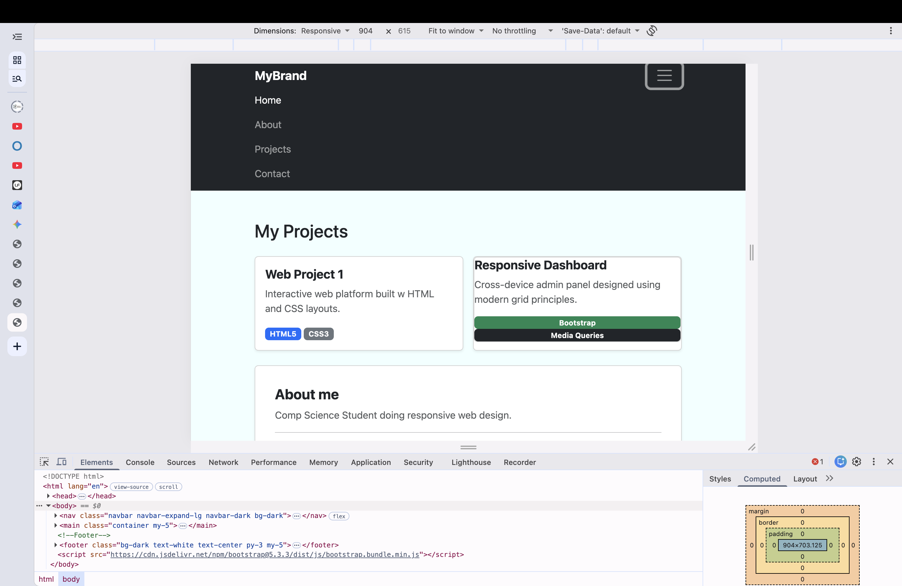

Desktop View:
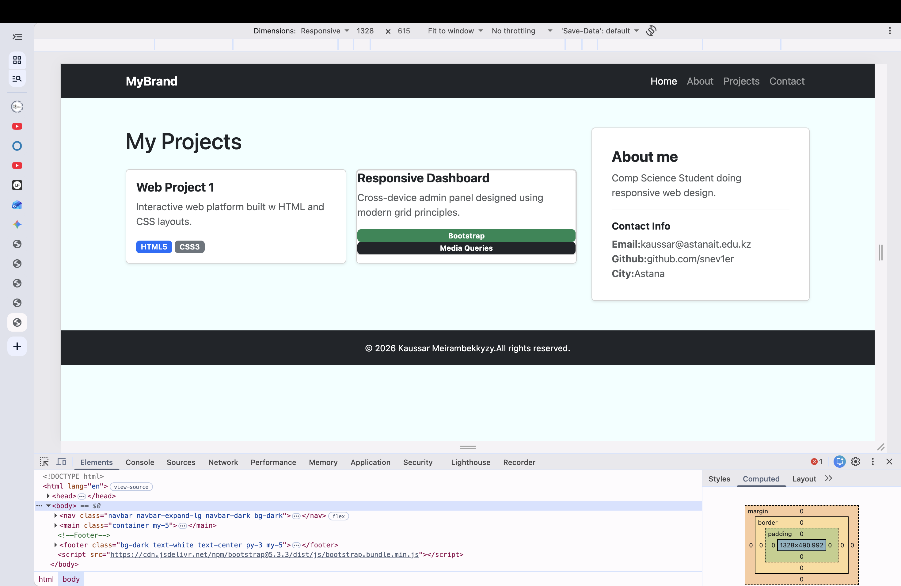

---

## Work Process Summary
During this assignment, I learned how to work with responsive design using both pure CSS media queries and the Bootstrap grid system. First, I set up media queries for typography and custom box layouts. After that, I learned how the 12-column grid works in Bootstrap and added an interactive navbar with JavaScript. Finally, I connected both methods together to build a complete portfolio webpage that looks good on mobile, tablet, and desktop devices.